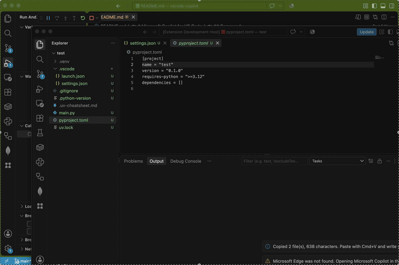

# Microsoft Copilot for VS Code

Open Microsoft Copilot next to VS Code and ask questions about your code without leaving your editor.



Microsoft Copilot for VS Code gives you a quick way to send selected code or workspace files to Microsoft Copilot. It opens Copilot in a dedicated Microsoft Edge app window or your default browser, so you can keep both tools side by side.

## Commands

- `Open Microsoft Copilot`: opens Copilot according to `copilotWeb.openMode`. By default, it uses a Microsoft Edge app window without tabs or an address bar. If Edge is not installed, it falls back to your default browser.
- `Open Microsoft Copilot in Browser`: opens Copilot in your default browser.
- `Ask Microsoft Copilot About Selection`: copies the selected text with an optional prompt (`copilotWeb.selectionPrompt`), opens Copilot, and lets you paste it with `Cmd+V` on macOS or `Ctrl+V` on Windows and Linux.
- `Ask Microsoft Copilot With Context Files`: opens a file picker with the active file and open editors preselected. Selected files are copied as `path + content`, including unsaved changes, and can then be pasted into Copilot. It works with any language and skips folders, binary files, and files larger than 1 MB.

## Access points

| Access point | Action |
| --- | --- |
| Command Palette | All commands |
| Explorer context menu (files or folders) | `Ask Microsoft Copilot With Context Files`, with Explorer selections preselected in the file picker |
| Editor context menu | `Ask Microsoft Copilot With Context Files`, and `Ask Microsoft Copilot About Selection` when text is selected |
| `Ctrl+Alt+Shift+M` (`Cmd+Alt+Shift+M` on macOS) | Asks about the editor selection, or opens Copilot when there is no selection |
| Status bar, `M365 Copilot` | `Open Microsoft Copilot` |

## Settings

| Setting | Default | Description |
| --- | --- | --- |
| `copilotWeb.openMode` | `appWindow` | `appWindow` (Microsoft Edge app window) or `browser` (default browser). |
| `copilotWeb.url` | `https://copilot.cloud.microsoft/` | Work or school account. Use `https://copilot.microsoft.com/` for a personal account. User settings only. |
| `copilotWeb.edgeProfile` | Empty | Edge profile folder, for example `Profile 1` (see `edge://version`). User settings only. |
| `copilotWeb.showStatusBar` | `true` | Shows or hides the status bar button. |
| `copilotWeb.selectionPrompt` | `Explain this {language} code:` | Text placed before selected code. `{language}` is replaced with the editor language. |
| `copilotWeb.contextPrompt` | `Use these files as context for my question:` | Text placed before context files. |
| `copilotWeb.contextMaxChars` | `30000` | Asks for confirmation when the copied context exceeds this number of characters. |
| `copilotWeb.contextExclude` | `node_modules`, `.git`, `out`, `dist`, `.venv`, `.env`, keys, images... | Patterns hidden in the file picker, in addition to `files.exclude` and `search.exclude`. Use one pattern per entry, without `{}` groups. |
| `copilotWeb.breakUrls` | `true` | Breaks URLs in copied text (`https://api.example.com` -> `https[:]//api[.]example[.]com`) so Copilot does not turn them into link attachments or try to open them. Applies to both `Ask` commands. Set to `false` to copy text unchanged. |

For security, `copilotWeb.url` and `copilotWeb.edgeProfile` are read only from user settings, so a repository cannot redirect the extension to another website. The URL is also restricted to the two official Copilot sites.

## Authentication

The extension does not manage authentication, OAuth, cookies, or tokens. Microsoft Copilot displays its own sign-in flow when needed, and you complete it manually.

Microsoft handles sign-in inside the Copilot window. It does not depend on your VS Code account, and the session is preserved between launches.

## Privacy

The `Ask ...` commands send selected code or chosen files to Microsoft Copilot when you paste them there. The file picker hides `.env` files, keys, and certificates by default, but files selected in the Explorer or already open in the editor may be preselected even when excluded; review the list before confirming.

With a work or school account on `copilot.cloud.microsoft`, Microsoft's enterprise data protection may apply. Check your organization's policy before pasting code or other sensitive content.

## Development

```bash
npm install
npm run lint
npm run typecheck
npm run test:unit            # mocha + ts-node
npm run test:unit:coverage   # coverage report in coverage/
npm run test:integration     # downloads VS Code and tests the extension inside it
npm run package              # generates the .vsix
```

### Debug the extension

You need:

- VS Code 1.95 or later.
- Node.js and npm.
- This repository opened as the root folder in VS Code.

Install the dependencies once before debugging:

```bash
npm install
```

Then:

1. Open a file under `src/` and set a breakpoint.
2. Press `F5` or choose `Run Copilot Web Extension` in the **Run and Debug** view.
3. VS Code automatically runs `npm: compile` and opens a new **Extension Development Host**.
4. Run any extension command in that window.
5. Use the original VS Code window to inspect variables, the call stack, and the **Debug Console**.

The debug configuration is in `.vscode/launch.json` and uses the compiled files in `out/`. After changing the code, press `F5` again to recompile and restart the Extension Development Host.

## Limitations

Microsoft Copilot cannot be displayed inside a VS Code tab. It uses `X-Frame-Options: SAMEORIGIN` and `frame-ancestors 'self'`, which prevent it from being loaded in an iframe or WebView. The extension therefore opens Copilot in an external window.
